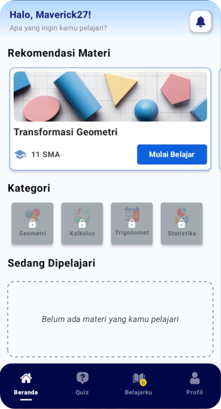
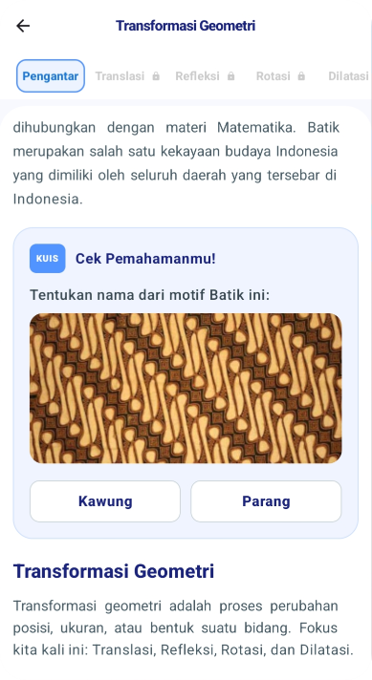
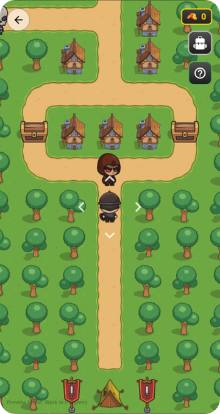
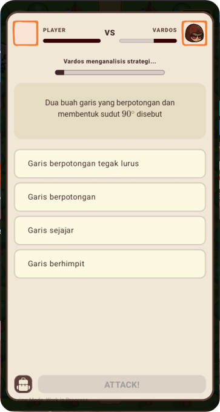
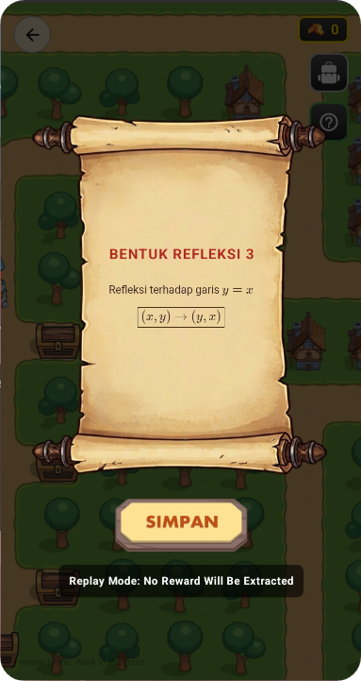
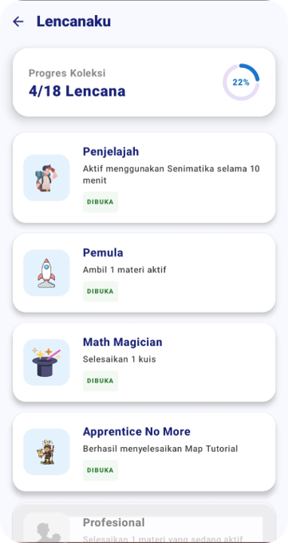

# Senimatika: Android-based Mathematics Learning Platform

**Senimatika** adalah aplikasi mobile berbasis Android yang memadukan elemen matematika, etnomatematika, dan gamifikasi. Aplikasi ini dirancang untuk memberikan pengalaman belajar matematika yang interaktif melalui kuis, eksplorasi peta, dan tantangan matematika yang semuanya diselesaikan dengan logika matematika.

---
## Fitur Utama

- **Annotation**: Fitur "coretan" untuk menandai pola/unsur pada suatu karya seni atau kebudayaan yang dikaitkan dengan konsep matematika.
- **Asynchronous Online Quiz**: Selesaikan kuis yang tersedia dengan tepat dan cepat. Adu skill matematika dengan pengguna lainnya untuk memperoleh skor tertinggi pada leaderboard.
- **Exploration Map**: Belajar matematika dengan menjelajahi peta fantasi. Ambil harta karun sebanyak-banyaknya dan pergi ke titik finsih untuk mengekstrak hasil buruan.
- **Boss Battle Quiz**: Pertempuran real-time melawan bos pada peta pantasi di mana setiap serangan ditentukan oleh kecepatan dan ketepatan menjawab kuis.
- **Station Quiz**: Tantangan spesifik di berbagai titik peta untuk membuka akses ke area tertentu.
- **MathText Rendering**: Dukungan penuh untuk notasi matematika kompleks (LaTeX) dan format teks Markdown.
- **Hybrid Zoom System**: Fitur zoom gambar native untuk memperjelas grafik soal tanpa mengganggu performa rendering teks.
- **Inventory & Power-Ups**: Gunakan item strategis seperti *Freeze Timer* atau *Healing Vial* untuk membantu menyelesaikan kuis sulit dalam melawan boss.

---

## Tech Stack & Optimasi

- **UI Framework**: [Jetpack Compose](https://developer.android.com/jetpack/compose) (100% Declarative UI).
- **Admin & Management**: [SenimatikaAdmin](https://github.com/hikaru1999/senimatika-admin) — Dashboard khusus untuk manajemen konten materi, kuis, dan pengelolaan data peta eksplorasi secara terpusat.
- **Backend**: [Firebase](https://firebase.google.com/) (Realtime Database, Authentication, & Cloud Storage).
- **Architecture**: MVVM (Model-View-ViewModel).
- **Dependency Injection**: [Hilt](https://dagger.dev/hilt/) (Dagger).
- **Asynchronous**: [Kotlin Coroutines](https://kotlinlang.org/docs/coroutines-overview.html) & Flow.
- **Math Rendering**: [KaTeX](https://katex.org/) terintegrasi via WebView yang dioptimalkan dengan *Lambda Offset* untuk mencegah *recomposition* berlebih.
- **Image Loading**: [Coil](https://coil-kt.github.io/coil/) untuk manajemen memori gambar yang efisien.

---

## Cara Menjalankan Proyek

Karena alasan keamanan dan efisiensi repositori, beberapa file telah dikecualikan (baca: `.gitignore`):

1. **Firebase Configuration**:
    - Sediakan file `google-services.json` dari project Firebase Anda.
2. **Multimedia Assets**:
    - File audio dan video berukuran besar tidak disertakan dalam repositori ini.
3. **Setup**:
    - Clone repositori ini.
    - Lakukan `Build Project` di Android Studio.
    - Pastikan koneksi internet aktif untuk sinkronisasi Firebase.

---
## Gallery
---
<p align="center">
  
  
  
</p>
<p align="center">
  
  
  
</p>

## Lisensi

Proyek ini dibuat untuk tujuan edukasi dan portofolio pribadi. Seluruh aset gambar dan suara adalah milik masing-masing kreator aslinya.

---

© 2026 Senimatika Team
=======
# 🎨 Senimatika - Catatan Pembaruan & Dokumentasi Aplikasi

[](https://developer.android.com/)
[](https://kotlinlang.org/)
[](https://developer.android.com/jetpack/compose)
[](https://firebase.google.com/)
[](#)

Selamat datang di **Senimatika** (Seni & Matematika), aplikasi pembelajaran matematika interaktif berbasis petualangan (*gamified learning*) yang memadukan konsep logika berhitung, eksplorasi dunia (*Mathventure*), serta pertarungan kuis kompetitif (*Math Arena*).

Dokumen ini memuat rangkuman pembaruan fitur, arsitektur sistem keamanan akun, mode belajar Math Arena, pengelolaan materi berbasis server (*Server-Driven Content*), sistem progresi level, dan penyegaran antarmuka visual (*UI Refreshment*).

---

## 🌟 Sorotan Pembaruan Terbaru (What's New)

### 1. 🔐 Manajemen Autentikasi & Keamanan Akun Terintegrasi
*Implementasi File:* [`AuthRepository.kt`](file:///c:/Users/Helvetica/Documents/Android%20Project/LearnApplication/app/src/main/java/com/LambdaProject/MathArt/data/repository/AuthRepository.kt), [`EmailVerificationModal.kt`](file:///c:/Users/Helvetica/Documents/Android%20Project/LearnApplication/app/src/main/java/com/LambdaProject/MathArt/ui/Pages/Profile/EmailVerificationModal.kt), [`EmailVerificationResultScreen.kt`](file:///c:/Users/Helvetica/Documents/Android%20Project/LearnApplication/app/src/main/java/com/LambdaProject/MathArt/ui/Pages/EmailVerificationResultScreen.kt), [`ForgotPasswordScreen.kt`](file:///c:/Users/Helvetica/Documents/Android%20Project/LearnApplication/app/src/main/java/com/LambdaProject/MathArt/ui/Pages/ForgotPasswordScreen.kt), [`ResetPasswordScreen.kt`](file:///c:/Users/Helvetica/Documents/Android%20Project/LearnApplication/app/src/main/java/com/LambdaProject/MathArt/ui/Pages/ResetPasswordScreen.kt), [`EditProfileModal.kt`](file:///c:/Users/Helvetica/Documents/Android%20Project/LearnApplication/app/src/main/java/com/LambdaProject/MathArt/ui/Pages/Profile/EditProfileModal.kt)

Untuk memastikan integritas data siswa dan keamanan profil pembelajaran, Senimatika kini dilengkapi alur autentikasi dan manajemen akun end-to-end:
- **Ganti Email dengan Re-Autentikasi Aman:** Pengguna dapat mengganti alamat email terdaftar melalui [`EditProfileModal.kt`](file:///c:/Users/Helvetica/Documents/Android%20Project/LearnApplication/app/src/main/java/com/LambdaProject/MathArt/ui/Pages/Profile/EditProfileModal.kt). Sistem mewajibkan verifikasi kata sandi aktif sebelum mengirimkan verifikasi email baru dan menyinkronkan data profil di Firestore.
- **Verifikasi Email Pengguna:**
  - Pengiriman tautan verifikasi otomatis menggunakan Firebase Action Code Settings.
  - Penanganan Deep Link via [`EmailVerificationResultScreen.kt`](file:///c:/Users/Helvetica/Documents/Android%20Project/LearnApplication/app/src/main/java/com/LambdaProject/MathArt/ui/Pages/EmailVerificationResultScreen.kt) untuk memverifikasi `oobCode` secara instan dari aplikasi.
  - Modal interaktif [`EmailVerificationModal.kt`](file:///c:/Users/Helvetica/Documents/Android%20Project/LearnApplication/app/src/main/java/com/LambdaProject/MathArt/ui/Pages/Profile/EmailVerificationModal.kt) dengan fitur kirim ulang tautan (*resend*) dan pemeriksaan status *real-time*.
- **Ganti Password (In-App Password Change):** Fitur pembaruan kata sandi berkala di dalam aplikasi yang memvalidasi kata sandi lama sebelum menerima kombinasi kata sandi baru yang memenuhi kriteria keamanan (minimal 6 karakter, kombinasi huruf dan angka).
- **Lupa Password & Pemulihan Kata Sandi Fleksibel:**
  - Layar [`ForgotPasswordScreen.kt`](file:///c:/Users/Helvetica/Documents/Android%20Project/LearnApplication/app/src/main/java/com/LambdaProject/MathArt/ui/Pages/ForgotPasswordScreen.kt) mendukung pemulihan akun melalui tautan email resmi maupun kode OTP 6 digit.
  - Layar [`ResetPasswordScreen.kt`](file:///c:/Users/Helvetica/Documents/Android%20Project/LearnApplication/app/src/main/java/com/LambdaProject/MathArt/ui/Pages/ResetPasswordScreen.kt) memfasilitasi penggantian kata sandi langsung dengan validasi kode `oobCode` secara aman di perangkat.

---

### 2. 🧠 Mode Belajar (Learning Mode) di Math Arena
*Implementasi File:* [`LearningExplanationOverlay.kt`](file:///c:/Users/Helvetica/Documents/Android%20Project/LearnApplication/app/src/main/java/com/LambdaProject/MathArt/ui/Pages/Multiplayer/LearningExplanationOverlay.kt), [`OnlineQuizMaster.kt`](file:///c:/Users/Helvetica/Documents/Android%20Project/LearnApplication/app/src/main/java/com/LambdaProject/MathArt/ui/Pages/Multiplayer/OnlineQuizMaster.kt), [`OnlineQuizLanding.kt`](file:///c:/Users/Helvetica/Documents/Android%20Project/LearnApplication/app/src/main/java/com/LambdaProject/MathArt/ui/Pages/Multiplayer/OnlineQuizLanding.kt), [`OnlineQuizLobby.kt`](file:///c:/Users/Helvetica/Documents/Android%20Project/LearnApplication/app/src/main/java/com/LambdaProject/MathArt/ui/Pages/Multiplayer/OnlineQuizLobby.kt)

Sebagai pelengkap dari kuis bertempo cepat dan mode duel kompetitif, kini hadir **Mode Belajar** yang dirancang murni untuk penguasaan konsep matematika tanpa tekanan persaingan:
- **Pengalaman Belajar Tanpa Tekanan Waktu (*Stress-Free Learning*):** Siswa dapat membaca dan menganalisis soal dengan tenang tanpa hitung mundur timer yang menghukum nilai.
- **Kartu Pembahasan Instan (*Interactive Explanation Overlay*):**
  - Setiap kali siswa menjawab dan mengetuk *"Periksa Jawaban"*, layar langsung memunculkan [`LearningExplanationOverlay.kt`](file:///c:/Users/Helvetica/Documents/Android%20Project/LearnApplication/app/src/main/java/com/LambdaProject/MathArt/ui/Pages/Multiplayer/LearningExplanationOverlay.kt).
  - Menyajikan ulasan detail: status jawaban (tepat/belum tepat), kunci jawaban sesungguhnya, rumus matematis yang berlaku, dan uraian langkah kerja komprehensif.
- **Identitas Visual Berbeda (Tema Hijau Zamrud):** Kartu dan navigasi kuis mode belajar ditandai secara visual dengan palet warna hijau zamrud (*emerald green*) dan lencana khusus *"Mode Belajar"*, membedakannya dari kuis kompetitif reguler (*sky blue*) dan duel (*purple/rose*).
- **Lobi Belajar Terfokus:** Menyembunyikan papan peringkat (*leaderboard*) kompetisi saat kuis mode belajar dipilih, mengarahkan fokus siswa sepenuhnya pada deskripsi materi dan latihan pemahaman.

---

### 3. ☁️ Arsitektur Konten Materi Berbasis Server (Server-Driven Content)
*Implementasi File:* [`MaterialContentModel.kt`](file:///c:/Users/Helvetica/Documents/Android%20Project/LearnApplication/app/src/main/java/com/LambdaProject/MathArt/data/model/MaterialContentModel.kt), [`MaterialRepository.kt`](file:///c:/Users/Helvetica/Documents/Android%20Project/LearnApplication/app/src/main/java/com/LambdaProject/MathArt/data/repository/MaterialRepository.kt), [`MaterialPage.kt`](file:///c:/Users/Helvetica/Documents/Android%20Project/LearnApplication/app/src/main/java/com/LambdaProject/MathArt/ui/Pages/Material/MaterialPage.kt), [`DynamicSectionScreen.kt`](file:///c:/Users/Helvetica/Documents/Android%20Project/LearnApplication/app/src/main/java/com/LambdaProject/MathArt/ui/Pages/Material/DynamicSectionScreen.kt), [`SummaryScreen.kt`](file:///c:/Users/Helvetica/Documents/Android%20Project/LearnApplication/app/src/main/java/com/LambdaProject/MathArt/ui/Pages/Material/SummaryScreen.kt)

Seluruh kurikulum, teks penjelasan, studi kasus budaya Nusantara, rumus matematika, hingga soal evaluasi kini dipisahkan dari kode biner aplikasi (*zero-code content delivery*):
- **Streaming Konten Dinamis via Firestore:** Materi dimuat langsung dari koleksi `materials`. Pendidik dan pengembang dapat menambah materi baru, memperbaiki tipografi, atau mengubah soal kuis tanpa perlu mengompilasi ulang atau merilis pembaruan APK di Play Store.
- **Koleksi Blok Konten Modular (*Rich Content Blocks*):**
  - 📐 **`FORMULA`**: Blok persamaan matematika interaktif lengkap dengan simbol dan penjelasan variabel.
  - 📝 **`WORKED_EXAMPLE`**: Pembahasan soal bertahap langkah demi langkah (*step-by-step problem walkthrough*) disertai tips pemecahan.
  - 🔄 **`FLIP_CARD`**: Kartu bolak-balik interaktif untuk menghafal konsep dan definisi penting secara menyenangkan.
  - 🔍 **`TRANSFORMATION_DEMO`**: Demonstrasi visual interaktif transformasi geometri pada motif batik/seni tradisional dengan perbandingan gambar sebelum dan sesudah.
  - 💡 **`CALLOUT` & `INTERACTIVE_CHECK`**: Kotak sorotan informasi penting (*Info/Tip/Warning*) dan mini kuis pemantik pemahaman di sela-sela bab.
  - 🎥 **`VIDEO` & `IMAGE`**: Pemutar video pembelajaran YouTube terintegrasi dan gambar aset beresolusi tinggi.
- **Efisiensi Kuota & Cache Cerdas:** Menggunakan strategi `Source.CACHE` di memori perangkat, sehingga pembacaan ulang materi tidak menghabiskan kuota data (*read quota*) Firestore.
- **Pelacakan Kemajuan & Proteksi EXP:** Progres bacaan bab dicatat per pengguna di `userProgress/{userId}`. Hadiah EXP materi terlindungi transaksi atomik sehingga hanya dapat diklaim 1 kali (*anti-farming*).
- **Layar Rangkuman Belajar Cerdas ([`SummaryScreen.kt`](file:///c:/Users/Helvetica/Documents/Android%20Project/LearnApplication/app/src/main/java/com/LambdaProject/MathArt/ui/Pages/Material/SummaryScreen.kt)):** Menampilkan metrik nilai, akurasi, dan status evaluasi (*Tuntas* vs *Perlu Ulang*) dengan judul motivasi yang adaptif dan bebas dari kontradiksi teks.

---

### 4. 🗺️ Peta Wilayah Interaktif untuk Mode Eksplorasi (Mathventure)
*Implementasi File:* [`DynamicMapModal.kt`](file:///c:/Users/Helvetica/Documents/Android%20Project/LearnApplication/app/src/main/java/com/LambdaProject/MathArt/ui/Pages/Exploration/DynamicMapModal.kt)
- **Visualisasi Peta Penuh:** Pemain kini dapat membuka modal peta interaktif untuk melihat seluruh tata letak dunia penjelajahan.
- **Pin Lokasi & Animasi Real-Time:** Menampilkan posisi pemain saat ini secara presisi dengan animasi detak (*pulsing radar*).
- **Statistik Penjelajahan Komprehensif:** Menyajikan persentase area yang telah dijelajahi (*Exploration Progress*), total peti harta karun terbuka (*Chests*), bos yang berhasil ditaklukkan (*Bosses Defeated*), serta stasiun matematika yang terselesaikan (*Solved Stations*).
- **Kompatibilitas Kabut & Malam:** Terintegrasi dengan mekanisme *Fog of War* dan *Night Mode*, sehingga bagian wilayah yang belum diinjak tetap diselimuti misteri hingga dijelajahi pemain.

---

### 5. ⚔️ Mode Duel Math Arena (Multiplayer 1v1 Real-Time)
*Implementasi File:* [`DuelMatchmakingOverlay.kt`](file:///c:/Users/Helvetica/Documents/Android%20Project/LearnApplication/app/src/main/java/com/LambdaProject/MathArt/ui/Pages/Multiplayer/DuelMatchmakingOverlay.kt)
- **Pertarungan Adu Ketangkasan Cepat:** Tantang lawan dalam duel kuis matematika waktu nyata satu lawan satu.
- **Matchmaking Radar Interaktif:** Animasi radar pemindaian lawan dengan efek audio dinamis saat mencari musuh.
- **Tampilan Head-to-Head (VS Screen):** Menampilkan profil kedua pemain secara berhadapan lengkap dengan Avatar, Bingkai Avatar (*Avatar Frame*), Gelar (*Title Badge*), dan Level pemain sebelum pertandingan dimulai.
- **Hitung Mundur Pertandingan:** Menghadirkan ketegangan jelang duel kuis dimulai dengan transisi halus.

---

### 6. 🎯 Sistem Misi Terstruktur di Mathventure
*Implementasi File:* [`Mission.kt`](file:///c:/Users/Helvetica/Documents/Android%20Project/LearnApplication/app/src/main/java/com/LambdaProject/MathArt/data/model/Mission.kt)
- Menghadirkan ragam tujuan spesifik di setiap rute petualangan untuk memicu strategi bermain yang variatif.
- **Tipe Misi yang Tersedia:**
  - `REACH_FINISH` : Capai bendera akhir petualangan.
  - `DEFEAT_BOSS` : Kalahkan monster bos matematika penjaga gerbang.
  - `COLLECT_CHEST` : Temukan dan buka peti harta karun tersembunyi.
  - `NO_POWER_UP` : Tantangan ekstra menyelesaikan rute tanpa menggunakan bantuan *power-up*.
  - `NO_BOSS_COMBAT` : Selesaikan penjelajahan dengan strategi menghindar tanpa memicu pertarungan bos.
- **Hadiah Misi:** Pemain yang berhasil menuntaskan misi mendapatkan imbalan langsung berupa **Bonus Koin** dan **Bonus EXP**.

---

### 7. 🎭 Kustomisasi Profil: Avatar Picker & Bingkai Avatar Kosmetik
*Implementasi File:* [`AvatarPickerModal.kt`](file:///c:/Users/Helvetica/Documents/Android%20Project/LearnApplication/app/src/main/java/com/LambdaProject/MathArt/ui/Pages/Profile/AvatarPickerModal.kt), [`AvatarFrameHelper.kt`](file:///c:/Users/Helvetica/Documents/Android%20Project/LearnApplication/app/src/main/java/com/LambdaProject/MathArt/utils/AvatarFrameHelper.kt)
- **Modal Pemilih Dua Tab:** Kemudahan berpindah antara tab **Pilih Avatar** dan tab **Pilih Bingkai**.
- **Koleksi Avatar Beragam:** Pemain bebas memilih karakter ilustrasi yang mewakili identitas diri mereka.
- **Bingkai Avatar Kosmetik Eksklusif:** Dilengkapi kalibrasi presisi posisi ornamen kosmetik pada avatar:
  - 🥉 **Bronze Rune** *(Unlocks Level 3)*: Bingkai perunggu bertatahkan batu safir.
  - 🌌 **Celestial Ring** *(Unlocks Level 6)*: Lingkaran kosmis astral dengan pendaran cahaya cyan.
  - 👑 **Sun Crown** *(Unlocks Level 10)*: Mahkota surya emas bercahaya dengan sayap suci.
  - 🌸 **Mystic Blossom** *(Unlocks Level 15)*: Ornamen kristal mistik legendaris bertabur kelopak bunga.
- **Pratinjau Langsung (Live Preview):** Tampilan gabungan avatar dan bingkai terpasang langsung dapat dilihat sebelum disimpan ke profil.

---

## 🏆 Tangga Progresi 15 Level & Sistem Reward

*Implementasi File:* [`LevelProgression.kt`](file:///c:/Users/Helvetica/Documents/Android%20Project/LearnApplication/app/src/main/java/com/LambdaProject/MathArt/data/model/LevelProgression.kt)

Pemain mengumpulkan saldo EXP kumulatif untuk meniti 15 jenjang kemahiran, membuka fitur game baru, emblem, tag gelar prestisius, dan hadiah legendaris:

| Level | Gelar (Title) | Syarat EXP | Jenis Hadiah | Rincian Hadiah yang Diperoleh |
| :---: | :--- | :---: | :---: | :--- |
| **1** | **Novice** | 0 EXP | Title | Tag Awal *"Novice"* |
| **2** | **Apprentice** | 300 EXP | Exploration | Emblem *"Book of Beginnings"* & **Mode Eksplorasi Terbuka** |
| **3** | **Learner** | 700 EXP | Frame | Emblem *"Curious Eye"* & Bingkai Avatar *"Bronze Rune"* |
| **4** | **Explorer** | 1.200 EXP | Power-Up | Power-up *Chrono Freeze* (2x) & Tag *"Explorer"* |
| **5** | **Thinker** | 1.800 EXP | Emblem | Emblem *"Crystal of Insight"* & Tag *"Thinker"* |
| **6** | **Solver** | 2.500 EXP | Frame | Emblem *"Breaker of Barriers"* & Bingkai Avatar *"Celestial Ring"* |
| **7** | **Strategist** | 3.400 EXP | Power-Up | Power-up *Torch* (1x) & Tag *"Strategist"* |
| **8** | **Trailblazer** | 4.350 EXP | Power-Up | Power-up *Healing Vial* (3x) & Tag *"Trailblazer"* |
| **9** | **Mathematician** | 5.500 EXP | Emblem | Emblem *"Order of Numbers"* & Tag *"Mathematician"* |
| **10** | **Expert** | 6.700 EXP | Frame | *Magic Key* (2x) & Bingkai Avatar *"Sun Crown"* |
| **11** | **Virtuoso** | 8.400 EXP | Emblem | Emblem *"Seal of Mastery"* & Tag Mewah *"Virtuoso"* |
| **12** | **Grandmaster** | 10.200 EXP | Power-Up | Power-up *Battle Shield* (3x) & Tag Mewah *"Grandmaster"* |
| **13** | **Prodigy** | 12.300 EXP | Power-Up | Item *Lantern* (1x) & Tag Mewah *"Prodigy"* |
| **14** | **Sage** | 14.750 EXP | Power-Up | Tag Mewah *"Sage"* & Paket Power-up Tempur Lengkap |
| **15** | **Scholar** | 17.500 EXP | **Legendary** | **Emblem Prestisius *"The Myth & The Legend"*** & **Bingkai Avatar *"Mystic Blossom"*** |

> [!TIP]
> **Klaim Hadiah Level:** Pemain dapat mengakses jendela modal katalog level (*Level Road*) melalui header dashboard atau profil untuk mengklaim hadiah di tiap level yang telah tercapai!

---

## ⚡ Sumber Perolehan EXP (EXP Sources)

Sistem progresi dirancang adil dan seimbang agar mendorong pemahaman materi secara konsisten:

1. **Materi Pembelajaran (First-Time Clear Reward):**
   - Menuntaskan seluruh bab bacaan materi memberikan hadiah EXP substansial (misal +150 EXP) yang hanya dapat diklaim satu kali (*anti-farming*).
2. **Math Arena:**
   - **Mode Belajar:** Menjawab soal dan membaca ulasan pembahasan tanpa timer.
   - **Mode Mandiri:** Menuntaskan kuis per topik matematika dengan bonus evaluasi kecepatan dan ketelitian.
   - **Mode Duel:** Memenangkan duel kuis matematika 1v1 melawan kompetitor (formula akurasi 50%, kecepatan 25%, streak 25%).
3. **Mathventure (Mode Eksplorasi):**
   - Menjelajahi ubin wilayah baru di peta, menuntaskan tantangan pos stasiun, membuka peti harta karun, dan menaklukkan bos matematika.
4. **Pencapaian (Achievements):**
   - Meraih milestone belajar tertentu, rekor streak kuis, dan penyelesaian seluruh materi bab.
5. **Mekanisme Anti-Grinding (*Repeat-Play Multiplier*):**
   - Pengulangan sesi materi/kuis yang sama menggunakan sistem proteksi atau reduksi perolehan EXP guna memotivasi siswa mempelajari topik-topik baru.

---

## 🌅 Penyegaran Tampilan Antarmuka (UI Refreshment)

### 🌄 Dashboard Header Dinamis
*Implementasi File:* [`DashboardHeader.kt`](file:///c:/Users/Helvetica/Documents/Android%20Project/LearnApplication/app/src/main/java/com/LambdaProject/MathArt/ui/Pages/Dashboard/DashboardHeader.kt)
- **Tema Langit Real-Time 4 Waktu (Sky Themes):**
  - 🌅 **Pagi (04.00 - 10.59):** Palet *Sunrise Orange* & *Peach Morning Sky*.
  - ☀️ **Siang (11.00 - 14.59):** Palet *Royal Sky Blue* cerah bertenaga.
  - 🌇 **Sore (15.00 - 17.59):** Palet *Sunset Amber*, *Soft Rose*, & *Twilight Lavender*.
  - 🌙 **Malam (18.00 - 03.59):** Palet *Moonlit Indigo Mist* & *Pale Lavender*.
- **Siluet Langit Artistik:** Ornamen ilustrasi siluet matahari pagi/siang/sore dan bulan malam yang muncul dinamis mengikuti jam perangkat.
- **Nama Pengguna WordArt:** Efek teks nama pengguna artistik yang menyesuaikan dengan emblem aktif yang dipilih.
- **Indikator Progres & Akses Cepat:** Bar progres EXP, sapaan dinamis, tanggal terformat bahasa Indonesia, serta tautan instan ke dialog *Level Road*.

### 👤 Profile Header yang Ditingkatkan
*Implementasi File:* [`ProfileHeader.kt`](file:///c:/Users/Helvetica/Documents/Android%20Project/LearnApplication/app/src/main/java/com/LambdaProject/MathArt/ui/Pages/Profile/ProfileHeader.kt)
- Tampilan kartu profil modern memadukan foto avatar berbingkai (*Avatar Frame*), badge gelar (*Title Badge*), dan emblem aktif.
- Visualisasi bar progres EXP menuju level berikutnya dengan perhitungan sisa EXP yang transparan.
- Akses instan satu ketukan untuk mengganti Avatar & Bingkai, membuka modal *Level Road*, atau meninjau laporan belajar.

---

## 🛠️ Tumpukan Teknologi (Tech Stack)

- **Bahasa Pemrograman:** [Kotlin](https://kotlinlang.org/) (JVM 11, Target SDK 35)
- **UI Framework:** [Jetpack Compose](https://developer.android.com/jetpack/compose) dengan Material Design 3
- **Dependency Injection:** [Dagger Hilt](https://dagger.dev/hilt/)
- **Backend & Database:** [Firebase Firestore](https://firebase.google.com/docs/firestore), [Firebase Authentication](https://firebase.google.com/docs/auth)
- **Arsitektur Konten:** Server-Driven Content (SDC) dengan renderer blok Compose dinamis
- **Manajemen State & Navigasi:** Jetpack Navigation Compose, ViewModel, Coroutines & Flow

---

## 📂 Struktur Berkas Utama Pembaruan

```text
app/src/main/java/com/LambdaProject/MathArt/
├── data/
│   ├── model/
│   │   ├── LevelProgression.kt         # Definisi 15 level, sistem reward & kalkulator EXP
│   │   ├── MaterialContentModel.kt     # Model data Server-Driven Content (SDC) modular
│   │   └── Mission.kt                  # Definisi objektif & misi penjelajahan Mathventure
│   └── repository/
│       ├── AuthRepository.kt           # Manajemen autentikasi, verifikasi & reset password
│       ├── MaterialRepository.kt       # Pengambilan & caching konten materi dinamis Firestore
│       └── SessionRepository.kt        # Pencatatan siklus sesi belajar pengguna
├── ui/
│   ├── Pages/
│   │   ├── Dashboard/
│   │   │   └── DashboardHeader.kt      # Header dashboard dengan tema langit 4 waktu & WordArt
│   │   ├── Exploration/
│   │   │   ├── DynamicMapModal.kt      # Modal peta interaktif untuk eksplorasi Mathventure
│   │   │   └── BagModal.kt             # Modal inventaris power-up & perlengkapan pemain
│   │   ├── Material/
│   │   │   ├── DynamicSectionScreen.kt # Renderer modular blok konten materi dari server
│   │   │   ├── MaterialPage.kt         # Container utama pager materi, kuis & hasil belajar
│   │   │   ├── QuizScreen.kt           # Layar evaluasi kuis interaktif per materi
│   │   │   └── SummaryScreen.kt        # Layar rangkuman hasil belajar & klaim reward EXP
│   │   ├── Multiplayer/
│   │   │   ├── DuelMatchmakingOverlay.kt # Overlay matchmaking radar untuk mode duel 1v1
│   │   │   ├── LearningExplanationOverlay.kt # Overlay kartu pembahasan instan Mode Belajar
│   │   │   ├── OnlineQuizLanding.kt    # Beranda Math Arena dengan pembeda Mode Belajar vs Duel
│   │   │   ├── OnlineQuizLobby.kt      # Lobi kuis dengan penyesuaian Mode Belajar
│   │   │   └── OnlineQuizMaster.kt     # Engine pengerjaan kuis interaktif & pembahasan
│   │   └── Profile/
│   │       ├── AvatarPickerModal.kt    # Dialog pemilihan avatar & bingkai kosmetik
│   │       ├── EditProfileModal.kt     # Modal pengubahan profil, email & password akun
│   │       ├── EmailVerificationModal.kt # Dialog verifikasi email pengguna
│   │       ├── LearningReportPage.kt   # Halaman analitik performa belajar siswa (Eksperimental)
│   │       ├── LevelRoadModal.kt       # Modal tangga klaim reward 15 level & manajemen gelar
│   │       └── ProfileHeader.kt        # Header halaman profil dengan avatar berbingkai
│   └── components/
│       ├── LevelEmblem.kt              # Komponen visual lencana emblem & WordArt
│       └── LevelTagBadge.kt            # Komponen badge gelar level
└── utils/
    ├── AvatarFrameHelper.kt            # Kalibrasi posisi & aset bingkai avatar
    └── AvatarHelper.kt                 # Manajemen katalog avatar pengguna
```

---

*Dikembangkan dengan penuh dedikasi oleh Tim Pengembang Senimatika.*
